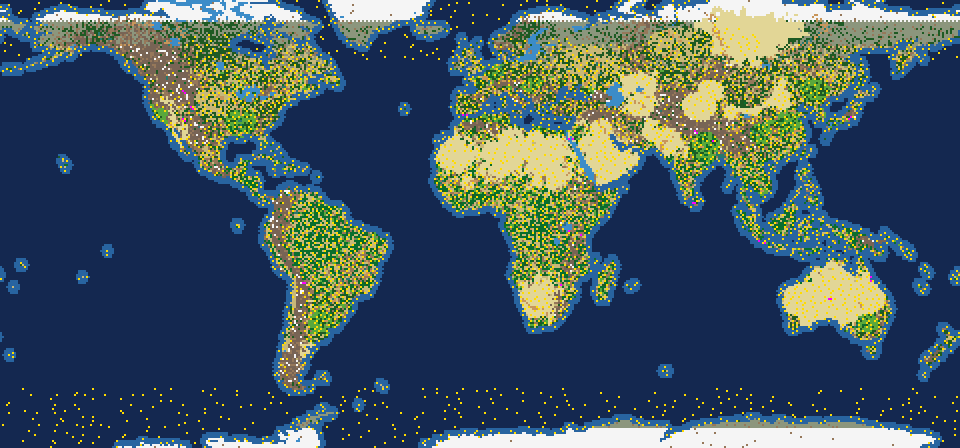

# Real World 480×224 — Unciv 世界地图

一张 107,520 格的现实世界六边形地图，海岸线与大陆轮廓由作者在 Unciv 地图编辑器中手工修整，地形、资源、宜居度按真实地理资料生成。

A 107,520-tile real-world map for Unciv 5.0.1+, with hand-refined coastlines and geography-based terrain, resources and habitability.

## 地图规格

| 项目 | 数值 |
|---|---|
| 网格 | 480 × 224 = 107,520 格，六边形，矩形，东西环绕 |
| 陆地 | 33,141 格（30.8%） |
| 山脉 / 丘陵 | 2,552 / 6,250 |
| 森林 / 丛林 / 沼泽 | 5,001 / 3,009 / 245 |
| 沙漠 | 5,598 |
| 雪原 / 冻土 | 4,935 / 4,268 |
| 资源 | 4,106 格（互不相邻，同种间距 ≥ 2 格） |
| 自然奇观 / 文明起源点 | 16 / 16 |

## 地形与宜居度设计

- **高纬极寒**：加拿大北部、西伯利亚、格陵兰等 60°N 以上区域以冻土/雪原为主，几乎没有产出与资源，接近不适合定居。
- **干旱区**：撒哈拉（西抵大西洋、南界 15–19°N 的萨赫勒过渡带）、阿拉伯、戈壁、塔克拉玛干、澳洲内陆、阿塔卡马、巴塔哥尼亚、大盆地等。
- **真实盆地 33 处**：四川、关中、塔里木、准噶尔、柴达木、吐鲁番、华北、东北、江汉、太湖、恒河、印度河、美索不达米亚、尼罗河三角洲、湄公河三角洲、潘诺尼亚、东欧、西欧、巴黎、波河、密西西比、北美大平原、加州中央谷地、亚马逊、拉普拉塔、奥里诺科、刚果、尼日尔河内三角洲、大自流、墨累-达令、西西伯利亚、库班、图兰。
- **真实高原 15 处**：青藏、蒙古、黄土、云贵、巴西、德干、东非、埃塞俄比亚、安纳托利亚、伊朗、亚美尼亚、科罗拉多、墨西哥、巴塔哥尼亚、阿巴拉契亚。
- **细长宜居带**：北非地中海沿岸、南美西海岸（安第斯与太平洋之间的狭窄平原带）、加州沿海谷地。
- **具体资源点 122 处**，按现实位置落点，例如：大庆、克拉玛依、胜利、Ghawar、Prudhoe Bay、Athabasca 油砂；攀枝花、白云鄂博、Pilbara、Carajás、Kiruna、Sishen；大同、开滦、鲁尔、顿巴斯、阿巴拉契亚；Chuquicamata、El Teniente、Norilsk、赞比亚铜带；Witwatersrand、Kalgoorlie、Muruntau；Olympic Dam、McArthur River；Weipa、几内亚铝土。

## 安装

1. 下载本仓库，或把整个文件夹放到 Unciv 的 mods 目录下：

   ```
   <Unciv>/mods/RealWorldMap/
   ├── jsons/ModOptions.json
   └── maps/Real World 480x224.map
   ```

2. 重启 Unciv，在 **Mods** 里确认 `Real WorldMap` 已加载。
3. **New Game** 时选择该地图；或在 **Map editor → Load** 中打开。

## 要求

- Unciv **5.0.1** 或更新版本（使用 5.0.1 的 `mapSize` 对象格式与 `StartingLocation` 结构）
- 107,520 格的渲染开销很大，桌面端建议 `java -Xmx8G -jar Unciv.jar`，或修改启动参数到 8G 堆

## 已知限制

- 地图编辑器打开整张大图非常慢，低配设备可能内存不足。
- 地图是按真实地理生成的创作，不是 1:1 测绘数据；海岸线经过手绘简化以适配 480×224 网格。

## 许可

地图数据由作者基于公开地理资料生成，建议以 CC BY 4.0 发布（可按需修改）。
Unciv 本体为 MPL 2.0，本项目不包含 Unciv 源码。

## 预览

